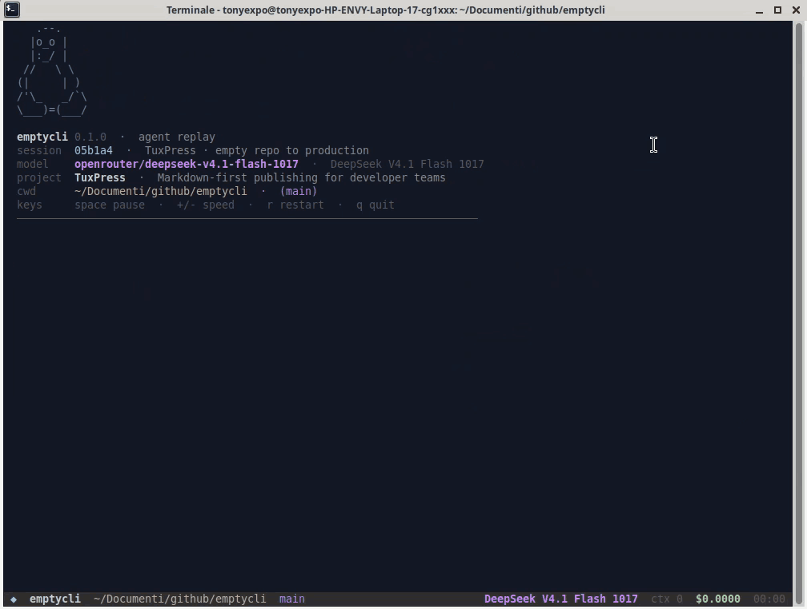

<div align="center">

# emptycli

**A CLI for lazy developers. Or for demos. Mostly for looking busy.**

*(Yes, it's sarcastic. Nothing here writes code. It just looks like it does.)*

[](https://github.com/tonyexpo/emptycli/actions/workflows/ci.yml)
[](LICENSE)
[](https://dotnet.microsoft.com/download)
[](#requirements)
[](#notes-and-limitations)
[](#notes-and-limitations)



</div>

## What is this?

`emptycli` is a **fictional agentic coding CLI**: the look and feel of a real coding agent
(streamed reasoning, tool calls, diffs, test output, todos, a live footer with context and
cost) without the agent, the model, the bill or the work.

Who it's for:

- **Lazy developers** who want the terminal to look productive while they get coffee.
- **Demos, talks and screen recordings** that need a convincing agent session, with no
  network, no API keys and no flaky live model.
- **Terminal UI nerds** curious about alternate screens, scroll regions and fixed footers.

It is a joke with a working implementation. Please don't present it as real work to
anyone who signs your paycheck.

It replays a ~30 minute software build (recon, scaffold, marketing site, backend, tests, CI
and deploy), scripted in [`replay.json`](replay.json). There is **no network access, no
package install, no database and no deployment**. The project, token usage, model output and
costs are fiction. The working directory, its folder name and the git branch shown in the
footer are real.

```
  ◆  emptycli  ~/github/emptycli  main        DeepSeek V4.1 Flash 1017  ctx 18.4k  $0.2731  12:48
```

## Quick start

```bash
git clone https://github.com/tonyexpo/emptycli.git
cd emptycli
./run.sh
```

Press `q` to quit when someone walks by. Or don't.

## What it does

- Plays 3,603 scripted events over ~29:45, then loops.
- Streams thinking and assistant output with markdown-ish wrapping and inline code.
- Renders tool calls as `Read`, `Write`, `Edit`, `Grep`, `Glob`, `Fetch`, `Task`, `Browser`
  and `$` shell commands, including colored diff hunks.
- Shows a fixed footer with:
  - the **real** current folder and git branch;
  - the model from `replay.json` (`openrouter/deepseek-v4.1-flash-1017` by default);
  - simulated context size, session cost and elapsed time;
  - pause/speed state.
- Supports pause, speed changes, restart and quit without leaving the terminal dirty.
- Degrades to plain streaming with `--no-tui` (useful for pipes and CI).

The screenplay builds **TuxPress**, a fictional Markdown-first publishing platform:
Next.js 15, Tailwind v4, Postgres + Drizzle, Better Auth magic links, a dashboard and
Markdown editor, revisions, API tokens, Vitest/Playwright, GitHub Actions and a production
deploy at `https://tuxpress.dev`.

## Requirements

- [.NET 10 SDK](https://dotnet.microsoft.com/download)
- A terminal with ANSI support (Linux, macOS or Windows Terminal)
- Python 3 only if you want to regenerate `replay.json`

The repo includes a `global.json` that accepts .NET 10 feature bands.

> **Ubuntu snap note:** in the stable channel the `dotnet` snap may expose the runtime
> only, with no SDK (`dotnet --list-sdks` is empty). `run.sh` detects that and falls back
> to a local `~/.dotnet` SDK when present; if only the snap runtime is available, it can
> run an already-built DLL. To build from source you still need a .NET 10 SDK (the
> `dotnet-sdk` snap currently ships .NET 8, which is not enough for `net10.0`).

## Run

```bash
./run.sh
```

or directly:

```bash
dotnet run --project src/EmptyCli
```

The app locates `replay.json` in the current directory, walks up to four parent directories,
then checks next to the executable. You can also pass a path explicitly.

### Controls

| Key | Action |
| --- | --- |
| `space` | Pause / resume |
| `+` / `-` | Increase / decrease playback speed |
| `r` | Restart the replay |
| `q` / `esc` | Quit |

### Options

```text
--speed <n>      Playback speed multiplier (default: 1; e.g. 4, 30, 200)
--once           Play a single session and exit
--no-tui         Stream normally without the alternate-screen footer
--no-color       Disable ANSI colors (NO_COLOR is also honoured)
--replay <path>  Load a different replay.json
-h, --help       Show help
-v, --version    Print the version
```

Examples:

```bash
./run.sh --speed 8              # ~3m 45s for the full loop
./run.sh --once --no-tui        # clean log, no alternate screen
./run.sh --replay ./my.json     # play a custom script
```

## The replay format

`replay.json` is a plain array of small events with a `gap` (seconds to wait before the
event) and an optional `ms` (how long its spinner/stream lasts). Every rendered line is an
event, which is why the file contains thousands of entries.

```json
{
  "version": 1,
  "meta": {
    "title": "TuxPress · empty repo to production",
    "project": "TuxPress",
    "model": "openrouter/deepseek-v4.1-flash-1017",
    "modelName": "DeepSeek V4.1 Flash 1017",
    "provider": "openrouter",
    "totalSeconds": 1785.4,
    "pricing": {
      "inputPerM": 0.28,
      "cachedInputPerM": 0.07,
      "outputPerM": 1.10
    }
  },
  "events": [
    { "kind": "phase", "gap": 1.2, "text": "Recon · empty repository" },
    { "kind": "user", "gap": 0.7, "text": "Build TuxPress …" },
    {
      "kind": "think",
      "gap": 0.45,
      "ms": 5200,
      "text": "The repository only contains …",
      "in": 11800,
      "cache": 8496,
      "out": 148
    },
    {
      "kind": "tool",
      "gap": 0.3,
      "ms": 240,
      "tool": "read",
      "arg": "README.md",
      "detail": "2 lines",
      "status": "ok"
    },
    { "kind": "line", "gap": 0.045, "text": "1 │ # emptycli", "style": "output" }
  ]
}
```

### Event kinds

| Kind | Purpose |
| --- | --- |
| `phase` | Section heading with elapsed timestamp |
| `user` | The initial prompt card |
| `think` | Streamed reasoning block; `ms` controls duration |
| `say` | Streamed assistant markdown |
| `tool` | Tool call header + spinner + result |
| `line` | One raw output/diff/log line with a style |
| `todo` | Full checklist or a compact status update |
| `note` | Dim system note (compaction, checkpoint) |
| `usage` | Optional invisible token usage event |

Useful `tool` fields: `tool`, `arg`, `detail`, `status` (`ok`, `error`, `running`), `add`,
`del`. Shell commands are `tool: "bash"` with `status: "running"` followed by `line` events
and a final status line. That is how a 70-second test run looks like a stream instead of a
single pause.

`line` styles: `plain`, `dim`, `muted`, `ok`, `err`, `warn`, `accent`, `bold`, `code`,
`path`, `add`, `del`, `hunk`, `ctx`, `output`, `rule`, `heading`, `user`.

Token fields (`in`, `cache`, `out`) drive the footer cost counter using `meta.pricing`.
Context size is the latest `in` value. Change the model name, pricing or entire screenplay
by editing the JSON; no code changes required.

## Regenerate the replay

The screenplay lives in [`tools/generate_replay.py`](tools/generate_replay.py):

```bash
python3 tools/generate_replay.py
```

It reports the resulting event count, duration, turns and estimated cost. The script is
deterministic (fixed random seed) and writes pretty-compact JSON.

## Project layout

```text
.
├── replay.json                 # the 3,603-event screenplay
├── run.sh                      # dotnet run wrapper (finds a local ~/.dotnet too)
├── global.json                 # pins .NET 10 feature band
├── src/EmptyCli/
│   ├── Program.cs              # startup, args, Ctrl+C handling
│   ├── CliOptions.cs           # argument parsing + help
│   ├── PlaybackController.cs   # clock, pause, speed, keyboard shortcuts
│   ├── PlaybackEngine.cs       # loop, usage accounting, restart behaviour
│   ├── SessionState.cs         # tokens, cost, session id
│   ├── EnvironmentInfo.cs      # real cwd, folder, home and git branch
│   ├── Replay/                 # JSON models + path resolution
│   └── Rendering/
│       ├── TerminalUi.cs       # alternate screen, scroll region, fixed footer
│       ├── MarkdownRenderer.cs # word-wrapped streaming markdown
│       ├── ReplayRenderer.cs   # event -> visual language
│       └── AnsiStyle.cs
└── tools/generate_replay.py    # build-log generator
```

### How the fixed footer works

In TUI mode the app enters the alternate screen, disables autowrap, reserves the last row
with a DECSTBM scroll region, and lets content scroll above it. The footer is redrawn with
the cursor saved/restored, so it never scrolls away. `q`/`Esc`/Ctrl+C restore the region,
cursor and original screen.

The footer adapts to width by dropping the context/speed segments, shortening the path and
finally removing the branch. The folder path and branch are read at runtime; the model,
tokens and cost come from the replay.

## Notes and limitations

- This is a **replay**, not an agent. It does not call a model, touch the network, execute
  the commands in the JSON or write the files shown in the diffs.
- The cost counter is derived from scripted token counts, not an invoice.
- The footer's `ctx` value resets when the screenplay compacts its fictional context.
- On terminals narrower than ~50 columns or shorter than 10 rows, use `--no-tui`.
- Windows is supported through Windows Terminal / modern conhost with VT sequences enabled.

## License

Apache-2.0. See [`LICENSE`](LICENSE).
